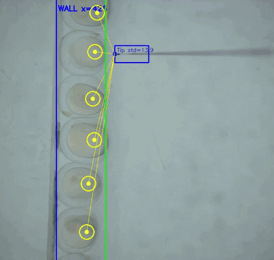
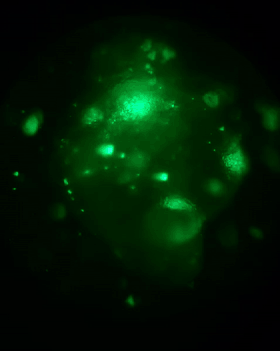

<h1 align="center">Automated Microinjection of Zebrafish Embryos</h1>

<p align="center">
  Vision-guided robotic platform that locates zebrafish embryos, aligns a glass
  micropipette on each viable one, detects the instant of contact from the image,
  and triggers the injection — then moves on to the next embryo.
</p>

<p align="center">
  
  
  
  
</p>

<table align="center">
  <tr>
    <td align="center"></td>
    <td align="center"></td>
  </tr>
  <tr>
    <td align="center"><sub><b>Automated run.</b> Embryos held in a row; the system tracks the<br>pipette tip, injects each viable embryo, and skips the ones already done.</sub></td>
    <td align="center"><sub><b>After injection.</b> Fluorescent tracer inside<br>the injected embryos confirms delivery.</sub></td>
  </tr>
</table>

> Research code developed at **ISIR (UMR 7222), Sorbonne University**, as part of
> work on automated handling of zebrafish embryos.

## Why it is hard

Microinjection into a zebrafish embryo is done by hand, one embryo at a time, by a
trained operator. The embryos are about 1 mm across, translucent, randomly oriented,
and some are dead. The operator knows the needle has reached the embryo by watching
the membrane deform — a visual cue, not a force reading.

This platform automates that loop: it decides which embryos are worth injecting,
drives the stage so the tip reaches them, recognises contact from the image, and
triggers an injection modelled on an operator's gesture.

## How it works

```
Basler camera ──frames──> YOLO segmentation ──> pipette mask + embryo labels
                                │
                                ├─> tip tracking      (vision/tip_tracker.py)
                                ├─> embryo tracking   (vision/embryo_tracker.py)
                                └─> contact classifier on a 64×64 patch
                                                       (vision/contact_classifier.py)
                                │
                     InjectionManager state machine
                                │
          ┌─────────────────────┴─────────────────────┐
          ▼                                           ▼
   StageController (XY, serial)             InjectorController (serial)
       Arduino stepper driver              Arduino stepper + AS5600 encoder
```

**Detection.** A YOLO segmentation model returns the micropipette mask and the
embryos, each labelled as viable (cytoplasm or yolk visible) or dead. Only viable
targets are queued; dead embryos and an operator-defined exclusion zone are skipped.

**Alignment.** `injection/alignment.py` compares the direction from the tip to the
target with the pipette axis and drives the XY stage until the angular error falls
within an adaptive tolerance, which widens with the vertical offset.

**Contact detection.** Instead of a force sensor, a small classifier runs on a 64×64
patch centred on the tip and fires at 0.99 confidence — reproducing what the operator
sees. This is what triggers the injection.

**Injection.** The injector Arduino plays a short four-phase velocity profile on its
stepper (`INJProfilArduino3/`), logs the commanded and measured speeds from an AS5600
magnetic encoder, then the pipette retreats to its recorded home angle.

**Memory.** `injection/processed_memory.py` remembers embryos already injected, with a
timeout, so a target that drifts out of frame and back is not injected twice.

## Repository layout

| Path | What it holds |
|---|---|
| `main.py` | Entry point — launches the Qt application |
| `InjectionGUI.py` | Operator interface: live view, manual control, run/stop |
| `vision/` | YOLO detector, tip and embryo trackers, contact classifier |
| `injection/` | Alignment, state machine, profile runner, exclusion zone, memory |
| `hardware/` | Basler camera, XY stage controller, injector controller |
| `config/` | Serial ports, tuning constants, filesystem paths |
| `utils/` | Unit conversion, FPS counter, video recording, geometry helpers |
| `INJProfilArduino3/` | Injector firmware: injection profile and encoder feedback |
| `stageXYonly/` | XY stage firmware |
| `AutreInjecteur/` | Firmware for an alternative injector |

## Getting started

### Requirements

- Python 3.11
- A Basler camera with the **pylon** runtime installed
- Two Arduino-driven axes on serial: XY stage and injector
- Trained weights: a YOLO segmentation model and a contact classifier

```bash
git clone https://github.com/AliouneDiouf/AutomatedInjectionOfZebrafishEmbryos.git
cd AutomatedInjectionOfZebrafishEmbryos
pip install -r requirements.txt
```

### Configuration

Serial ports live in `config/hardware.py`:

```python
SERIAL_PORT_STAGE  = "COM4"     # /dev/ttyACM0 on Linux
SERIAL_PORT_INJECT = "COM7"
```

Model and data locations are read from environment variables, with defaults under
the project root:

| Variable | Default | Contents |
|---|---|---|
| `ZINJ_MODEL_DETECT` | `models/tip_embryo_seg.pt` | YOLO segmentation weights |
| `ZINJ_MODEL_CONTACT` | `models/contact_classifier.pt` | Contact classifier weights |
| `ZINJ_PROFILE_CSV` | `profiles/injection_profile.csv` | Recorded operator profile |
| `ZINJ_VIDEO_DIR` | `recordings/` | Output videos |

Model weights are not distributed with this repository.

Tuning constants — contact confidence, approach distance, memory timeout, mechanical
conversion — are gathered in `config/constants.py`.

### Run

```bash
python main.py
```

## Status

Research prototype. The code runs the full loop on the bench; it is not a validated
instrument and carries no medical or regulatory status.

## Author

**Alioune Badara Diouf** — R&D Engineer, Computer Vision & Robotics
ISIR (UMR 7222), Sorbonne University
[badaradiouf101@gmail.com](mailto:badaradiouf101@gmail.com) ·
[LinkedIn](https://www.linkedin.com/in/alioune-badara-diouf-019036120)
